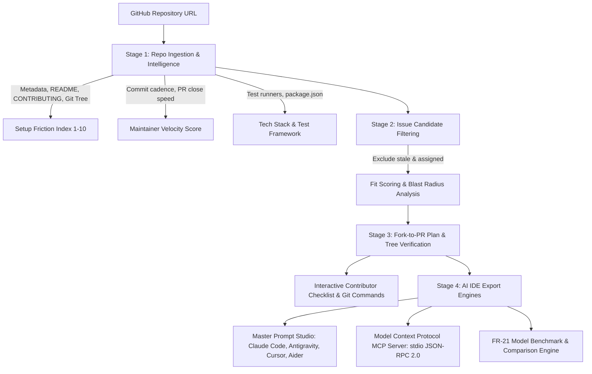

# ClayPull 🚀

<div align="center">


<br/>

[](LICENSE)
[](https://nodejs.org)
[](https://vitejs.dev)
[](https://react.dev)
[](https://ollama.com)
[](mcp/server.js)
[](https://hacktoberfest.com)

**Transform any GitHub repository URL into a friction-free contributor roadmap, complete with tree-verified file targets, an interactive fork-to-PR checklist, surgical Master Prompts for 5 AI agents, and a native Model Context Protocol (MCP) server.**

[Quick Start](#-quick-start-in-under-60-seconds) • [Local Setup Guide](SETUP.md) • [Features](#-core-features) • [Architecture](#-architecture--pipeline) • [MCP Server](#-model-context-protocol-mcp-server) • [Master Prompt Studio](#-master-prompt-studio) • [Clay Design System](#-clay-design-system)

</div>

---

## 🌟 The Problem & The ClayPull Solution

First-time open-source contributors face overwhelming friction before writing a single line of code:
* **Directory Mazes**: Large enterprise repositories contain hundreds of directories; newcomers struggle to know where to begin.
* **Stale or Trap Issues**: Many `good first issue` tags are years old, already assigned, or mask deceptively complex architectural refactors.
* **Blast Radius Uncertainty**: Beginners fear breaking existing unit tests or touching sensitive production logic.
* **Cloud Privacy & Cost**: Modern AI coding tools frequently require expensive monthly subscriptions or send sensitive code to closed cloud servers.

**ClayPull** eliminates these roadblocks:
1. **Zero-Cloud Requirement**: Runs 100% locally on open-weight models (**Qwen 2.5 Coder**, **Llama 3.2**) via **Ollama** with zero data egress, plus cloud fallbacks (Groq, OpenRouter, OpenAI, DeepSeek) and an offline Demo Mode.
2. **Deep Architectural Intelligence**: Calculates an automated **Setup Friction Score (1-10)**, evaluates Maintainer Velocity, detects test frameworks (Vitest/Jest/Pytest), and identifies hotspot files.
3. **Blast Radius Rating**: Filters candidate issues, eliminating stale or assigned tickets, and scores each issue for risk (`Low / Isolated` vs `Moderate`).
4. **Verified File Targets**: Cross-references prospective edit targets against the repository's real-time Git tree (`verified` vs `predicted`).
5. **Master Prompt Studio**: Automatically writes surgical, ready-to-run prompts tailored for **Claude Code CLI**, **Google Antigravity**, **Cursor / Windsurf**, **GitHub Copilot / Codex**, and **Aider**.
6. **Native Model Context Protocol (MCP)**: Directly connects ClayPull to your AI IDE, allowing agents to analyze repositories and triage issues autonomously.

---

## 🏗️ Architecture & Pipeline



---

## ⚡ Quick Start (In Under 60 Seconds)

### 1. Automated Setup
ClayPull features a built-in health check and setup wizard that installs dependencies, provisions `.env`, checks Ollama, and verifies binaries.

```bash
# Clone the repository
git clone https://github.com/saurabh-rajput-15/firstpr.git
cd firstpr

# Run the automated setup wizard
npm run setup

# Launch the development server
npm run dev
```

*Windows PowerShell users can alternatively run `.\setup.ps1`, and Linux/macOS users `./setup.sh`.*

### 2. Access the Application
- **🎨 Clay.com Landing Page**: [http://localhost:5174/](http://localhost:5174/)
- **📊 Studio Dashboard**: [http://localhost:5174/dashboard](http://localhost:5174/dashboard)

> 📖 **Need step-by-step instructions for Ollama, API keys, or IDEs?** See the complete [Local Development & Setup Guide (SETUP.md)](SETUP.md).

---

## 🖥️ Dual-Interface Experience

ClayPull delivers two dedicated user interfaces tailored for both exploration and in-depth developer workflows:

### 1. Clay.com Landing Page (`/`)
* **Cream Canvas (`#fffaf0`)**: Warm, friendly atmosphere inspired by the handcrafted Clay.com visual language.
* **Plain Black Display Typography**: Bold, negative-tracking headlines paired with legible Inter body typography.
* **Saturated Feature Cards**: 6 signature Clay accents (Hot Pink, Deep Teal, Lavender, Peach, Ochre, and Mint).
* **3D Mascot & Landscape**: Organic illustrations celebrating the contributor journey.
* **Unified Footer**: Warm, consistent cream palette across the entire experience.

### 2. ClayPull Studio Dashboard (`/dashboard`)
* **Responsive Sidebar Navigation**: Instantly toggle between:
  1. 📊 **Overview & Deep Intelligence**: Setup Friction Index, Maintainer Velocity, Hotspots, and Setup Commands.
  2. 🎯 **Triaged Issues & PR Plans**: Filtered tickets ranked by contributor fit with Blast Radius tags, verified file targets, interactive step-by-step checklists, and 1-click Git branch commands.
  3. 🪄 **Master Prompt Studio**: Surgical, per-repo instructions for 5 AI agent tools.
  4. 🔌 **MCP Server & AI-IDE Hub**: Pre-built configurations for Google Antigravity, Claude Desktop, Cursor, and Windsurf.
  5. ⚖️ **Model Benchmark & Comparison (FR-21)**: Side-by-side model evaluation measuring latency, rubric scores, and recommendations.
  6. ⚙️ **Model & API Settings**: Switch between Local Ollama, Cloud endpoints (Groq, OpenRouter, OpenAI, DeepSeek), and Offline Demo Mode.

---

## 🔌 Model Context Protocol (MCP) Server

ClayPull ships with a production-ready stdio JSON-RPC 2.0 MCP server located in [`mcp/server.js`](mcp/server.js).

### Native Tools Exposed

| Tool Name | Description |
|---|---|
| `claypull_analyze_repo` | Ingests repository metadata, README, conventions, and computes setup friction. |
| `claypull_triage_beginner_issues` | Finds open beginner issues, filters stale tickets, and scores contributor fit. |
| `claypull_generate_pr_plan` | Produces verified file targets, step-by-step fork-to-PR checklist, and test commands. |
| `claypull_export_agent_prompt` | Generates master prompts formatted for Claude Code, Antigravity, or Cursor. |

### Connecting to AI IDEs

#### Google Antigravity IDE
Add to your Antigravity IDE MCP configuration:
```json
{
  "mcpServers": {
    "claypull": {
      "command": "node",
      "args": ["c:/Users/saura/Downloads/hacktoberfest/mcp/server.js"],
      "env": {
        "OLLAMA_ENDPOINT": "http://localhost:11434"
      }
    }
  }
}
```

#### Claude Desktop
In `%APPDATA%\Claude\claude_desktop_config.json` (Windows) or `~/Library/Application Support/Claude/claude_desktop_config.json` (macOS):
```json
{
  "mcpServers": {
    "claypull": {
      "command": "node",
      "args": ["<PATH_TO_CLAYPULL>/mcp/server.js"]
    }
  }
}
```

#### Cursor & Windsurf
Add to your project's `.cursor/mcp.json`:
```json
{
  "mcpServers": {
    "claypull": {
      "command": "node",
      "args": ["${workspaceFolder}/mcp/server.js"]
    }
  }
}
```

---

## 🪄 Master Prompt Studio

For any analyzed repository and selected issue, ClayPull crafts surgical instructions configured specifically for your preferred AI agent:

### 1. Claude Code CLI
```bash
claude "Resolve issue #1042 in facebook/react. Target verified file: docs/getting-started.md. Run vitest before pushing."
```

### 2. Google Antigravity
Generates structured prompt blocks conforming to Antigravity's surgical pair-programming principles:
```markdown
<TASK>
Resolve issue #1042 in facebook/react: Fix typo in documentation.
</TASK>
<SURGICAL_TARGET_FILES>
- docs/getting-started.md (Verified in tree)
</SURGICAL_TARGET_FILES>
<VERIFICATION_CRITERIA>
1. All changes confined strictly to target documentation.
2. Run npm test to verify markdown linter passes.
</VERIFICATION_CRITERIA>
```

### 3. Cursor & Windsurf
Outputs system prompts with `@file` annotations and strict regression prevention rules.

### 4. Aider
Generates git-aware CLI commands:
```bash
aider docs/getting-started.md --message "Resolve issue #1042: Fix typo in documentation and verify formatting."
```

---

## 💻 Standalone Terminal CLI

ClayPull includes a command-line interface in [`bin/claypull.js`](bin/claypull.js) for terminal enthusiasts and CI pipelines:

```bash
# Analyze a repository using the offline demo engine (instant evaluation)
npm run cli -- analyze facebook/react --demo

# Analyze with local Ollama
npm run cli -- analyze pallets/flask --model qwen2.5-coder:7b

# Export a Markdown report
npm run cli -- analyze torvalds/linux --demo --out linux-report.md

# Compare two models
npm run cli -- compare facebook/react --demo
```

*(Note: `bin/firstpr.js` is preserved as a transparent alias for backward compatibility).*

---

## 🦙 Pluggable AI Models

ClayPull puts you in total control of your AI inference:

1. **Local Ollama (Recommended)**: Private, open-weight models running on your machine (`qwen2.5-coder:7b`, `llama3.2`, `codellama`). ClayPull automatically proxies requests through `/ollama` in Vite to eliminate browser CORS restrictions.
2. **Cloud APIs**: 1-click presets for **Groq Cloud** (`llama-3.3-70b-versatile`), **OpenRouter**, **OpenAI** (`gpt-4o-mini`), and **DeepSeek**.
3. **Offline Demo Mode**: Zero setup, zero downloads, and zero API keys—ideal for hackathon judges, workshops, and classroom demonstrations.

---

## 🎨 Clay Design System

ClayPull adheres to the distinctive, playful B2B SaaS aesthetic of **Clay.com**:

| Design Token | Value | Purpose |
|---|---|---|
| **Canvas Background** | `#fffaf0` | Cream-tinted warm base canvas |
| **Ink Color** | `#0a0a0a` | High-contrast dark navy typography |
| **Card Radius** | `1.25rem` / `1.5rem` | Soft, rounded organic containers |
| **Hot Pink Card** | `#ff4d8d` | Hero accent and primary actions |
| **Teal Card** | `#0d9488` | Deep technical intelligence & code markers |
| **Lavender Card** | `#8a5cf6` | AI Prompt Studio & MCP badges |
| **Peach Card** | `#ff8a65` | Issue fit scoring and checklist highlights |
| **Ochre Card** | `#eab308` | Setup friction warnings & alerts |
| **Mint Card** | `#10b981` | Verification checks & successful PR status |

---

## 🧪 Testing, Quality & CI/CD

ClayPull enforces strict code quality and continuous integration:

- **Linting**: ESLint configured with strict rules (`npm run lint` — **0 errors, 0 warnings**).
- **TypeScript**: Strict type checking with TypeScript 6 (`tsc -b`).
- **Bundle Optimization**: Built with Vite 8 (`npm run build` — completes in < 2.0s).
- **GitHub Actions**: Automated CI workflow in [`.github/workflows/ci.yml`](.github/workflows/ci.yml) running on Node 22 for all pushes and PRs to `main`.

---

## 📁 Repository Structure

```
├── .github/workflows/ci.yml     # Automated GitHub Actions CI pipeline
├── bin/
│   ├── claypull.js              # Standalone ClayPull CLI executable
│   └── firstpr.js               # Backward-compatible CLI alias
├── mcp/
│   └── server.js                # Model Context Protocol stdio JSON-RPC server
├── public/                      # Static assets & favicon
├── scripts/
│   └── setup.js                 # Cross-platform setup & health check wizard
├── src/
│   ├── components/
│   │   ├── Dashboard.tsx        # Studio Dashboard (Overview, Issues, Prompts, MCP)
│   │   ├── LandingPage.tsx      # Clay.com playful landing page
│   │   └── ErrorBoundary.tsx    # React error boundary with Clay-styled recovery
│   ├── App.tsx                  # Client-side router & persistence layer
│   ├── export.ts                # Markdown report & benchmark matrix generator
│   ├── index.css                # Clay design system CSS tokens & styles
│   ├── llm.ts                   # Pluggable LLM client (Ollama, Groq, OpenAI, Demo)
│   ├── main.tsx                 # Application entry point
│   ├── masterPrompts.ts         # Agent prompt studio (Claude, Antigravity, Cursor)
│   ├── mcp.ts                   # MCP IDE configuration generators
│   ├── pipeline.ts              # Repository ingestion & triage intelligence
│   └── types.ts                 # TypeScript type definitions
├── .env.example                 # Environment variables template
├── LICENSE                      # MIT License
├── README.md                    # Main project documentation
├── SETUP.md                     # Complete local developer setup guide
├── setup.ps1                    # PowerShell setup script for Windows
├── setup.sh                     # Bash setup script for Linux / macOS
└── package.json                 # Dependencies & scripts
```

---

## 🏆 Hackathon Submission Details

- **Event:** Hacktoberfest Hack Day Dhule × ARIF
- **Track:** Best Open-Source AI Project
- **Project Name:** ClayPull
- **Author:** Saurabh Rajput ([@saurabh-rajput-15](https://github.com/saurabh-rajput-15))
- **Repository:** [https://github.com/saurabh-rajput-15/firstpr](https://github.com/saurabh-rajput-15/firstpr)
- **License:** MIT License

---

<div align="center">
Built with ❤️ for first-time open-source contributors worldwide.
</div>